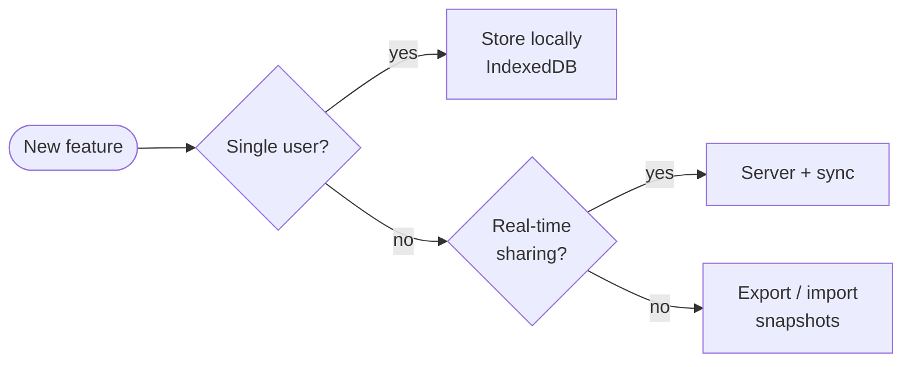
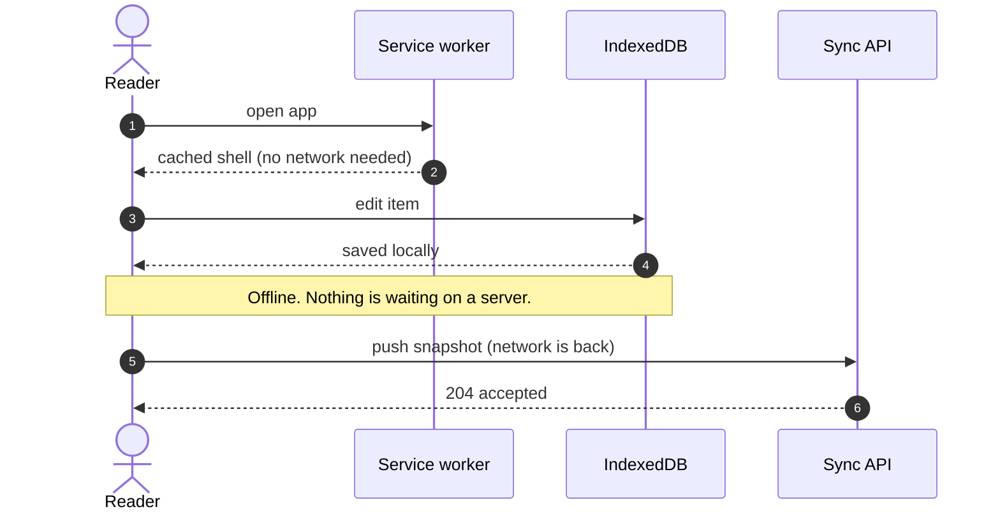
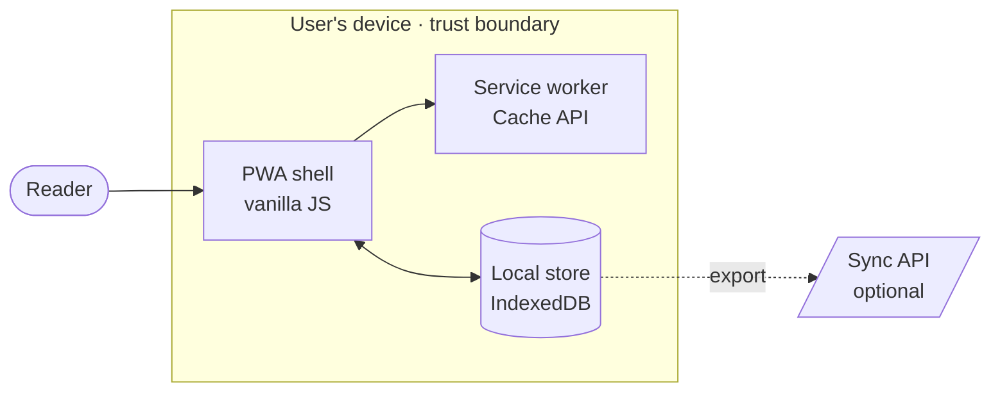

A diagram exported as a PNG has one terrible property: nobody can tell what changed. Move one arrow and the whole file differs, so reviewers either skip it or approve it blind. A diagram written as **text** has the opposite property — a one-line change is a one-line diff.

This post is the companion to [Diagrams belong next to the code]({{ '/2026/diagrams-belong-next-to-the-code/' | relative_url }}). That one was about images; this one is about drawing from source.

## The whole idea in ten lines

Write a fenced code block and name the language `mermaid`. The page turns it into a live diagram, styled to match the blog and the current theme:

Flip the theme toggle and the diagram re-colours itself. Click it for a full-screen view. If JavaScript is switched off or the library can't load, you still get the source, readable as code.

## Behaviour belongs in a sequence diagram

Boxes and arrows show *structure*. For *behaviour over time* — who calls whom, in what order — a sequence diagram is better, and it's the one most worth keeping next to the code that implements it:

## Architecture views, C4 style

Architects mostly want boundaries: what sits inside the trust boundary and what sits outside it. A flowchart with a `subgraph` draws exactly that, and — unlike Mermaid's dedicated C4 syntax, which is still experimental and ignores the page theme — it follows your colours in light and dark:

For the full C4 toolchain — models, several views from one source, workspaces — use a dedicated tool such as Structurizr, then drop an exported image into the post with the [image pattern]({{ '/2026/diagrams-belong-next-to-the-code/' | relative_url }}).

## Habits that keep diagrams useful

1. **One question per diagram.** If you can't state what it answers in a sentence, split it.
2. **Label the arrows.** An arrow without a verb is decoration.
3. **Add `%% caption:` and `%% alt:` lines.** The caption explains it to everyone; the alt text explains it to people who can't see it.
4. **Keep it small enough to read without zooming** — or mark it `%% wide`.
5. **Review it like code.** If a pull request changes behaviour, it should change the diagram in the same commit.

{: .callout}
**Try it:** open the source toggle under any diagram above, change a label, and compare the diff you would see in a pull request with the diff a new PNG would give you.
