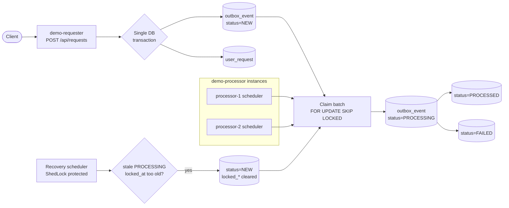
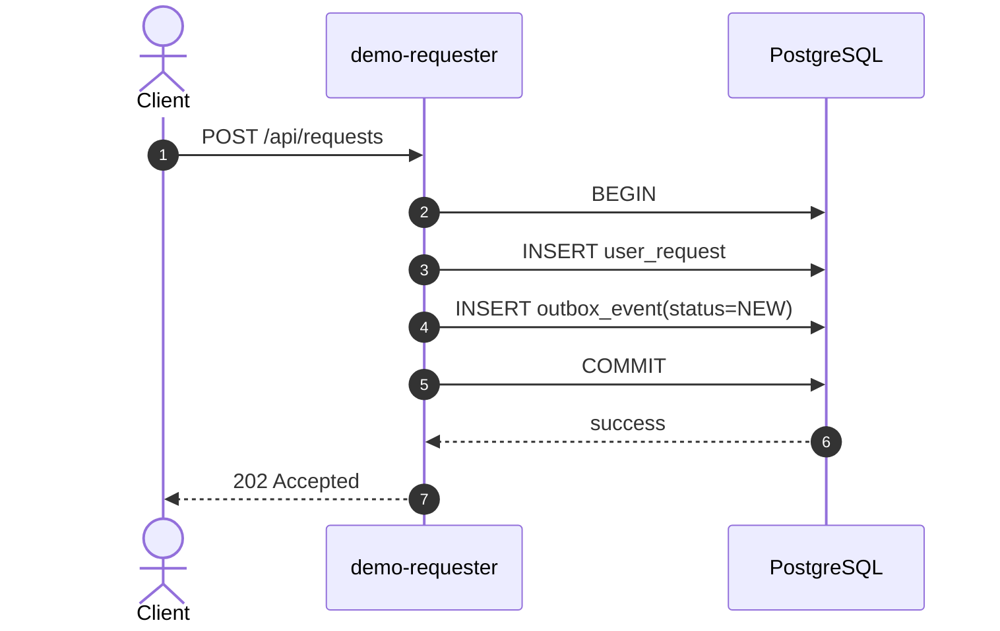
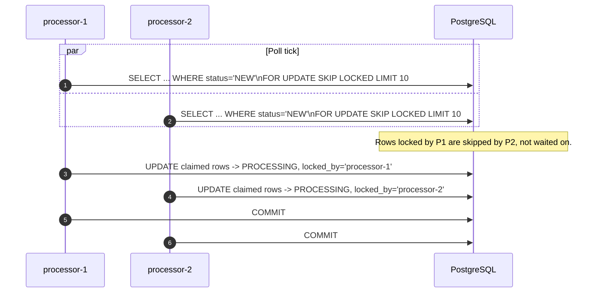
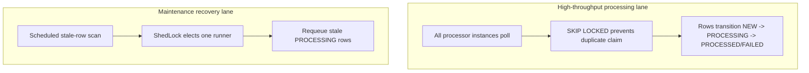
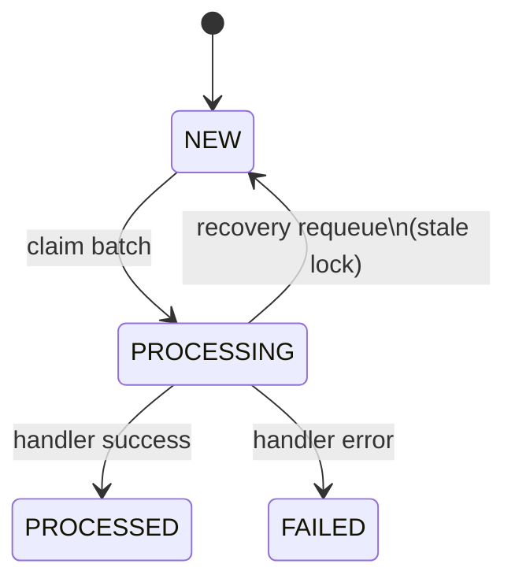

Most architecture diagrams make event delivery look clean: write once, process once, done. Real systems are less polite. Instances restart. Network calls fail. One worker gets slower than the rest. If the design is weak, "event-driven" becomes "event-mystery-driven".

This case study shows a deliberately small, testable setup that behaves like a production shape:

- `demo-requester` accepts API calls and writes business data + outbox event in **one transaction**.
- `demo-processor` runs on multiple instances and processes outbox rows with `FOR UPDATE SKIP LOCKED`.
- A recovery scheduler (ShedLock-protected) requeues stale `PROCESSING` rows after worker crashes.

The goal is not novelty. The goal is confidence: you can explain *why* no duplicate claim happens, *why* stalled rows are recovered, and *what* each instance is doing in SQL terms.

## Repository

> TODO: Add GitHub repository link here once published.
>
> Example: `https://github.com/<your-org-or-user>/<repo-name>`

## The whole design in one flowchart

## Why the split matters: write path and process path fail differently

Putting "write business data" and "publish event" in separate systems creates an unavoidable gap. The transactional outbox closes that gap because both writes happen in the same commit.

No message broker is needed to prove the pattern. The outbox table itself is the durable hand-off.

## Parallel claim without duplicate claim

`FOR UPDATE SKIP LOCKED` is the key to safe multi-instance polling.

Important nuance: this guarantees **disjoint claims**, not equal distribution. Faster workers tend to claim more over time.

## Where ShedLock helps (and where it doesn't)

For claim loops using `SKIP LOCKED`, ShedLock is optional for correctness. For maintenance jobs, it is operationally valuable.

In plain terms:

- `SKIP LOCKED` protects row-claim concurrency.
- ShedLock protects singleton maintenance behavior.

Using both in the right place keeps throughput and predictability together.

## State model as an engineering contract

Treat status transitions as an explicit contract, not an incidental implementation detail.

If a transition is not in the diagram, it should not be in code.

## What this case study proves in practice

1. **No write gap:** API data and outbox event commit atomically.
2. **No duplicate claim in parallel pollers:** concurrent workers claim disjoint sets.
3. **Crash tolerance:** stale `PROCESSING` rows are returned to `NEW` by scheduled recovery.
4. **Operability:** `locked_by`, `locked_at`, attempts and status counts make behavior explainable from SQL.

{: .callout}
**Try it:** run two `demo-processor` instances with different `-Ddemo.processor.instance-name` values, submit 30 requests, and inspect `outbox_event`. You should see both instances in `locked_by`, uneven but valid distribution, and clear status transitions.

