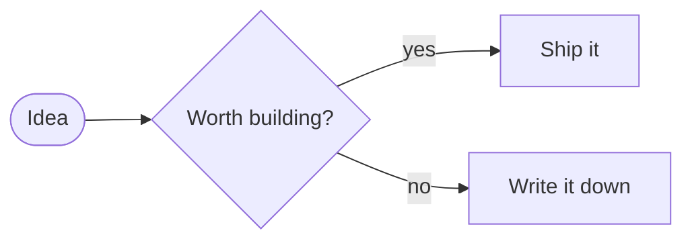
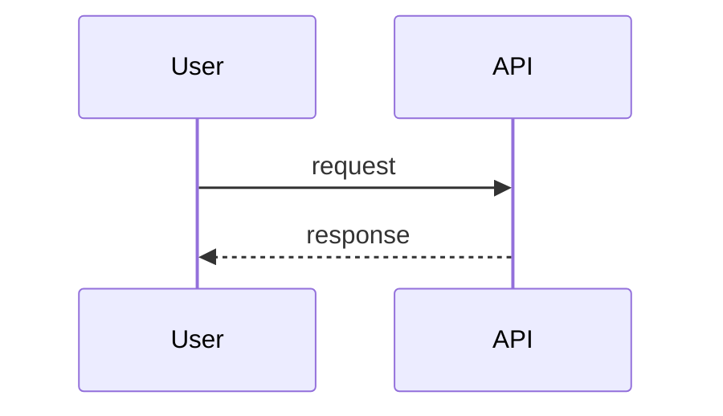

# Diagrams from code (Mermaid)

Write a diagram as text in a post and the page draws it — themed to the blog, light and dark,
click-to-zoom, with the source one click away. A complete example lives in
`_posts/2026-10-22-draw-it-in-text-review-it-in-a-pull-request.md`.

## 1. Basic use

Add a fenced code block whose language is `mermaid`:

````markdown

````

That's all. No plugin, no front matter, no build step.

## 2. Caption, alt text and width (all optional)

Put special comment lines at the top of the block. They're removed before drawing:

````markdown

````

| Line | Effect |
| --- | --- |
| `%% caption: …` | Numbered caption under the diagram (shares the "Fig." numbering with images). |
| `%% alt: …` | Accessible description. Say what the diagram *means*, not that it is a diagram. |
| `%% wide` | Lets the diagram extend slightly beyond the text column on large screens. |

## 3. What readers get

- **Theme-aware:** colours come from the blog's own palette and re-draw when the theme is toggled.
- **Click or press Enter** on a diagram for a full-screen view; Esc closes it.
- **View diagram source:** a collapsed block with a copy button, so people can reuse your diagram.
- **Graceful fallback:** if JavaScript is off, the library can't load, or the syntax is invalid,
  the source stays visible (with an error note) instead of a blank gap.
- **Loaded only when needed:** the library (about 3.5 MB, cached after the first load) is fetched
  only on pages that actually contain a diagram. Pages without diagrams pay nothing.

## 4. Which diagram types work well

| Type | Starts with | Good for | Follows theme |
| --- | --- | --- | --- |
| Flowchart | `flowchart LR` / `TD` | Decisions, pipelines, container views using `subgraph` | Yes |
| Sequence | `sequenceDiagram` | Behaviour over time, API and sync flows | Yes |
| State | `stateDiagram-v2` | Lifecycles and status models | Yes |
| Class / ER | `classDiagram`, `erDiagram` | Domain and data models | Yes |
| Gantt, pie, timeline | `gantt`, `pie`, `timeline` | Plans and distributions | Mostly |
| C4 | `C4Context`, `C4Container` | Experimental in Mermaid; uses fixed colours | **No** |

**C4 views:** draw them as a flowchart with a `subgraph` for the boundary (see the example post).
For full C4 modelling use Structurizr and publish an exported image with
[`figure.html`](images.md).

## 5. Tips

- One question per diagram; label every arrow.
- Use `<br/>` inside labels for line breaks.
- Keep node text short — long labels shrink the whole diagram. Use `%% wide` or split it.
- Try drafts in the live editor at <https://mermaid.live>, then paste the text in.
- Review diagram changes in pull requests like code: a one-line change is a one-line diff.

## 6. Technical notes

- Library: Mermaid 11, self-hosted at `assets/js/vendor/mermaid.min.js` (MIT licence file alongside).
  No third-party requests are made. To upgrade, replace that file with a newer `dist/mermaid.min.js`.
- Rendering uses `securityLevel: "strict"`, which sanitises labels and disables click handlers.
- Where it's wired: `assets/js/main.js` (search for "Diagrams from code") and the
  `.diagram` rules in `assets/css/main.css`.
- Content Security Policy: GitHub Pages sets none by default. If you add one, allow
  `script-src 'self'` and inline styles for the generated SVG.
